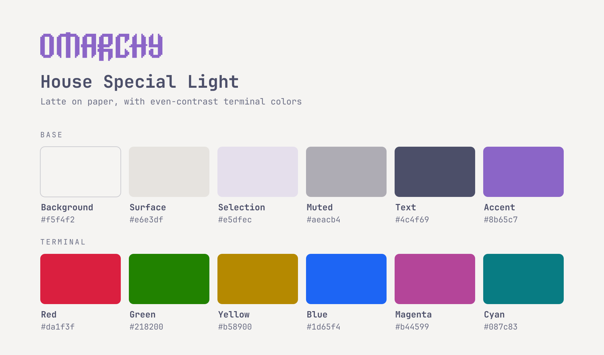

# House Special Light

A light Catppuccin Latte theme for [Omarchy](https://omarchy.org), tuned so every color reads well on paper. It's the daytime sibling of [House Special Dark](https://github.com/stewartjarod/omarchy-house-special-dark-theme).



## What makes it special

- **Neutral paper background** (`#f5f4f2`) instead of Latte's cool, blue-tinted base.
- **Dusty mauve accent** (`#8b65c7`) for focused window borders, menus, the launcher, the lock screen and btop highlights, matching the purple icon set. It is Latte's mauve with the saturation brought down, so it doesn't glare on a light background.
- **Selection** tinted with the accent (`#e5dfec`), not a grey-blue block.
- **Even-contrast terminal colors.** Red, green, cyan, blue and magenta are adjusted in lightness only (hue and vividness kept) to 4.5:1 against the background, the usual minimum for small text. Stock Latte ranges from 2.4:1 to 4.9:1, so yellow and pink are hard to read.
- **Yellow and orange that still look yellow and orange.** Darkening them to 4.5:1 turns them brown, so yellow is Solarized's gold (`#b58900`) and orange is a true burnt orange (`#d75f00`).
- **Two wallpapers:** Latte's pastel color fade and the Omarchy logo in mauve.

## Colors

| | Hex | Contrast on background |
|---|---|---|
| Text | `#4c4f69` | 7.3:1 |
| Accent | `#8b65c7` | 4.0:1 |
| Red | `#da1f3f` | 4.5:1 |
| Green | `#218200` | 4.5:1 |
| Cyan | `#087c83` | 4.5:1 |
| Blue | `#1d65f4` | 4.5:1 |
| Magenta | `#b44599` | 4.5:1 |
| Orange | `#d75f00` | 3.5:1 |
| Yellow | `#b58900` | 2.9:1 |

## Install

```bash
omarchy theme install https://github.com/stewartjarod/omarchy-house-special-light-theme
```

To switch between this theme by day and House Special Dark by night, run a small script from a systemd timer that calls `omarchy theme set house-special-light` in the morning and `omarchy theme set house-special-dark` in the evening.

## Credits

- Colors from the [Catppuccin](https://catppuccin.com/palette/) Latte palette (MIT).
- Yellow from [Solarized](https://ethanschoonover.com/solarized/) by Ethan Schoonover (MIT).
- The color-fade wallpaper, the logo wallpaper and the unlock art come from Omarchy's Catppuccin Latte theme, recolored. The Omarchy logo belongs to the [Omarchy](https://github.com/omacom/omarchy) project (MIT).

## License

[MIT](LICENSE)
